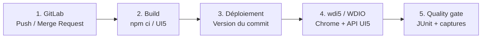

# Automatiser les tests SAPUI5 & SAP Fiori avec wdi5

*Note de conception / proposition de mise en œuvre*

De la validation manuelle à une preuve de qualité systématique à chaque push GitLab.

| **3 familles**             | **2 niveaux**              | **1 objectif**         |
|----------------------------|----------------------------|------------------------|
| custom · extension · Fiori | smoke rapide · E2E intégré | détection avant fusion |

Périmètre : applications SAPUI5 custom, extensions d’applications standard et SAP Fiori (freestyle / Fiori elements, selon accessibilité).

Version 1.0 \| 30 octobre 2026 \| Public cible : responsables techniques, qualité, DevOps, équipes SAP

Statut : dossier de cadrage et conception cible — à adapter à l’architecture SAP et à la politique GitLab de l’organisation.

# Synthèse pour décision

La proposition consiste à intégrer wdi5 (service WebdriverIO utilisant l’API de test UI5) au cycle de développement GitLab, afin de rejouer automatiquement les parcours métiers prioritaires sur chaque changement et d’afficher les résultats dans les Merge Requests.

> **Condition de validité** — Le test doit s’exécuter sur la version issue du commit testé : application démarrée localement à partir des sources du commit, ou déploiement en environnement de validation identifié. Tester une URL stable qui contient une ancienne version ne constitue pas une preuve du push.

## Résultats attendus

- Détecter rapidement une régression sur un écran, une extension standard ou un parcours Fiori sans répétition manuelle systématique.
- Rendre visibles les preuves : résultat pass/fail, temps d’exécution, erreurs et captures d’écran en artefacts GitLab.
- Utiliser un quality gate : une régression critique fait échouer le job et peut bloquer la fusion lorsque les règles GitLab l’exigent.
- Industrialiser un socle mutualisé de sélecteurs UI5, pages métiers et jeux de données réinitialisables.

## Choix d’architecture proposés

| **Décision**        | **Recommandation**                                                                                                        |
|---------------------|---------------------------------------------------------------------------------------------------------------------------|
| Périmètre initial   | 1 application custom + 1 extension standard + 1 parcours Fiori représentatif.                                             |
| Outillage           | wdi5 / WebdriverIO 9, Node.js LTS, Chromium/Chrome via Selenium distant en CI.                                            |
| Déclencheurs        | Push de branche puis pipeline de Merge Request ; exécution de régression complète sur branche principale / planification. |
| Stratégie           | Tests UI rapides avec mocks ; tests E2E réels sur une version déployée et des données maîtrisées.                         |
| Livrables de preuve | Rapports JUnit XML, logs, captures d’écran, indicateurs de fiabilité et de durée.                                         |

## Critères de succès du pilote

Suite smoke reproductible (objectif indicatif : ≤ 10 minutes), 0 test critique rouge pour fusionner, taux de tests instables \< 3 % après stabilisation, et mesure du temps humain réellement évité. Ces seuils sont des cibles à confirmer après la baseline du pilote.

# 1. Contexte, enjeux et périmètre

## 1.1 Pourquoi automatiser aux pushs GitLab ?

Les tests manuels pré-release ne suivent pas toujours la fréquence des livraisons. Une modification mineure de contrôleur, modèle, routing, extension ou annotation peut casser une fonctionnalité visible sans être détectée lors de la revue de code. Un pipeline intégré fait remonter cette information pendant le cycle de développement, lorsque le coût de correction reste limité.

## 1.2 Trois familles d’applications

| **Famille**               | **Ce que l’on teste**                                                                                       | **Spécificité de conception**                                                                        |
|---------------------------|-------------------------------------------------------------------------------------------------------------|------------------------------------------------------------------------------------------------------|
| SAPUI5 custom / freestyle | Ouverture, routing, recherche, saisie, validation, sauvegarde, états des messages.                          | IDs stables contrôlés par l’équipe ; démarrage local avec mock puis E2E réel.                        |
| SAP standard étendu       | Fonction ajoutée par controller extension, adaptation, fragment, action, champ ou extension Fiori elements. | Ne pas dépendre des IDs générés du standard ; garder une suite de non-régression standard minimale.  |
| SAP Fiori / Launchpad     | Navigation FLP, rôles/catalogues, intent, liste/détail, interaction OData, autorisations.                   | Tester le shell et l’application selon le contexte ; gérer SSO, données, client SAP et accès réseau. |

Hors périmètre du seul wdi5 : performance de charge, sécurité applicative exhaustive, vérification ABAP unitaire et couverture systématique des règles métiers côté backend. Les conserver dans leurs outils dédiés.

## 1.3 Principe de complémentarité des tests

- QUnit : tests unitaires rapides (formatters, fonctions, logique isolée).
- OPA5 : tests d’intégration UI5 proches de l’application, avec mock server si pertinent.
- wdi5 : tests de bout en bout dans un vrai navigateur, avec sélecteurs UI5 et scénarios transverses.

# 2. Architecture de référence

Le pipeline part du code versionné, prépare une application testable, lance les parcours automatisés et publie des résultats exploitables. La séparation entre tests rapides et tests intégrés évite de ralentir tous les commits par des validations coûteuses.



**Deux circuits complémentaires :**

- **A — Tests rapides :** mocks / interface locale, à chaque push.
- **B — E2E intégrés :** Fiori Launchpad et services SAP, sur MR / branche principale.

Schéma cible : seule la branche de validation E2E nécessite les services SAP/FLP réels. Le pipeline doit tracer le commit effectivement testé.

## 2.1 Composants techniques

| **Composant**           | **Fonction / responsabilité**                                                                 |
|-------------------------|-----------------------------------------------------------------------------------------------|
| Dépôt GitLab            | Code SAPUI5, tests wdi5, page objects, configuration WDIO et pipeline CI/CD.                  |
| Runner GitLab           | Exécute npm ci, build, déploiement contrôlé et jobs de tests.                                 |
| Navigateur automatisé   | Chrome/Chromium headless ; service Selenium Grid/Standalone ou infrastructure équivalente.    |
| wdi5 + WebdriverIO      | Pilote le navigateur et interroge les contrôles UI5 via des sélecteurs proches d’OPA5.        |
| Environnement sous test | Application locale avec mocks pour smoke ; préproduction / tenant / client SAP pour E2E réel. |
| GitLab Reports          | Publie JUnit XML, traces, captures et statut du job ; consultation dans pipeline / MR.        |

## 2.2 Flux logique de validation

**01** Commit poussé → pipeline créé par règles GitLab, sans doublon push/MR.

**02** Build et vérifications rapides ; artefact produit depuis le commit.

**03** Démarrage mock ou déploiement ciblé en validation ; URL + identifiant de version transmis au job.

**04** Exécution wdi5 avec compte de test et données connues.

**05** Publication des rapports JUnit et captures même en cas d’échec ; quality gate sur tests critiques.

# 3. Stratégie de test par application

| **Niveau**              | **Déclenchement recommandé** | **Durée visée\*** | **But**                                            |
|-------------------------|------------------------------|-------------------|----------------------------------------------------|
| L0 — Build + unitaires  | Chaque push                  | 1 à 4 min         | Syntaxe, logique, dépendances.                     |
| L1 — Smoke wdi5 mock    | Chaque push / MR             | 3 à 10 min        | Parcours UI critiques indépendants du backend.     |
| L2 — E2E wdi5 intégré   | MR / branche protégée        | 10 à 25 min       | Backend, authentification, rôles, FLP, extensions. |
| L3 — Régression étendue | Planifiée (nuit) / release   | Selon volume      | Couverture élargie et multi-rôles.                 |

\* Durées indicatives, non mesurées : elles dépendent de l’infrastructure, des données et de la parallélisation.

## 3.1 Conception des sélecteurs et scénarios

- Priorité à un ID de contrôle stable + viewName (custom), ou à des sélecteurs UI5 sémantiques précis (controlType, propriétés, binding/context).
- Éviter les IDs techniques générés, XPath fragiles, index de lignes, sélecteurs basés sur texte traduit sauf nécessité métier.
- Encapsuler la sélection dans des Page Objects : l’évolution d’une vue ne doit pas modifier tous les tests.
- Vérifier l’état métier (valeur affichée, message, transition, donnée créée), pas seulement qu’un bouton a pu être cliqué.
- Préparer des données de test isolées ; répéter le scénario 3 fois pour vérifier l’idempotence et diagnostiquer les flakiness.

## 3.2 Exemples de parcours prioritaires

| **Application** | **Smoke P0**                                                 | **E2E P1**                                                                              |
|-----------------|--------------------------------------------------------------|-----------------------------------------------------------------------------------------|
| Custom          | Ouvrir écran, filtrer liste, valider champ obligatoire.      | Créer/mettre à jour une demande, vérifier l’enregistrement.                             |
| Standard étendu | Voir champ/action ajouté(e), ouvrir dialogue d’extension.    | Exécuter l’action ajoutée, vérifier effet backend et absence de régression du standard. |
| Fiori / FLP     | Accéder via intent, afficher liste/détail avec rôle attendu. | Navigation multi-écrans, contrôles OData et règles d’autorisation.                      |

# 4. Prérequis et conception des environnements

## 4.1 Préparer le socle technique

**01** Recenser les applications : namespace UI5, version SAPUI5, type de déploiement (ABAP / BTP), routes, dépendances OData, accès Launchpad.

**02** Créer une branche pilote ; installer Node.js LTS et les dépendances wdi5 / WDIO compatibles ; figer les versions dans package-lock.json.

**03** Sélectionner un GitLab Runner ayant accès aux URL de test et au navigateur ; prévoir le réseau vers S/4HANA/FLP et certificats de confiance.

**04** Créer un compte technique de test à privilèges minimaux, autorisé à utiliser les fonctionnalités ciblées ; définir la stratégie SSO/MFA validée par la sécurité.

**05** Mettre en place des données réinitialisables et un espace technique dédié (tenant/client, utilisateur, préfixe d’objets).

## 4.2 Matrice de disponibilité

| **Question à confirmer**                                  | **Critère de validation**                                                                |
|-----------------------------------------------------------|------------------------------------------------------------------------------------------|
| Le Runner atteint-il le serveur UI5 et les services SAP ? | HTTP(S), DNS, proxy, certificats et pare-feu validés.                                    |
| Le test correspond-il au commit ?                         | Identifiant de build/commit exposé ou rapport de déploiement traçable.                   |
| Peut-on rejouer 10 fois sans pollution ?                  | Réinitialisation des jeux de données ; nettoyage des créations.                          |
| Quelle authentification ?                                 | Service account non nominatif, parcours conforme à IAM ; pas de secrets en dépôt.        |
| Quelle politique de pipeline MR ?                         | Pas d’accès aux secrets protégés pour code non approuvé ; revue des forks.               |
| Quel niveau de test sur le standard ?                     | Accès aux contrôles, stabilité des sélecteurs et comportement lors des mises à jour SAP. |

> **Point d’attention SSO / FLP** — wdi5 agit dans le navigateur, mais n’élimine ni les contraintes d’authentification ni la disponibilité du backend. Préférer les mécanismes de test approuvés par l’équipe IAM ; ne jamais désactiver MFA ou contourner les contrôles en production.

# 5. Organisation du projet et démarche de réalisation

## 5.1 Arborescence recommandée

```text
project/
├── webapp/                     # Application SAPUI5 (ou extension)
├── test/e2e/
│   ├── specs/                 # Scénarios *.spec.js
│   ├── pages/                 # Page Objects / sélecteurs UI5
│   ├── data/                  # Jeux de données non sensibles
│   └── wdio.conf.cjs         # Config WebdriverIO / wdi5
├── ci/deploy-to-validation.sh # Adaptateur de déploiement (à développer)
├── package.json
├── package-lock.json
└── .gitlab-ci.yml
```

## 5.2 Phases de mise en œuvre

| **Phase**            | **Travaux**                                                               | **Livrable / test de sortie**                      |
|----------------------|---------------------------------------------------------------------------|----------------------------------------------------|
| P1 Cadrage           | Inventaire des applications, dépendances, 10 parcours métiers, criticité. | Matrice applicative + backlog P0/P1 approuvé.      |
| P2 POC local         | Installer wdi5, écrire 2 à 3 tests custom, stabiliser Page Objects.       | Tests reproductibles sur poste et depuis CLI.      |
| P3 GitLab smoke      | Runner, Chrome/Selenium, JUnit, captures, règles push/MR.                 | Pipeline GitLab qui échoue sur régression simulée. |
| P4 E2E intégré       | Déployer le commit, comptes/SSO, données SAP, FLP, extensions standard.   | Suite intégrée traçable et rejouable.              |
| P5 Industrialisation | Seuils qualité, documentation, formation, pilotage et monitoring.         | Quality gate en MR + tableau de bord KPI.          |

## 5.3 Gouvernance proposée

Un référent SAPUI5 possède les Page Objects et les sélecteurs ; un référent QA possède la couverture et les jeux de données ; l’équipe DevOps possède la fiabilité des runners, les artefacts et les droits CI/CD ; la sécurité valide les comptes techniques. Toute nouvelle fonctionnalité P0 doit proposer son test automatisé dans la MR.

# 6. Exemple de configuration wdi5

Exemple minimal de départ pour un environnement de test servi via une URL connue. Les versions du socle doivent être verrouillées par package-lock.json ; la configuration finale dépend de la version retenue et du mode d’hébergement.

## 6.1 Initialiser les dépendances

```bash
# À lancer à la racine de l’application SAPUI5
npm init wdi5@latest

# Ajouter le reporter JUnit si le générateur ne le prévoit pas
npm install --save-dev @wdio/junit-reporter

# Enregistrer et committer package.json + package-lock.json
```

Alternative : intégrer manuellement wdio-ui5-service et les dépendances WebdriverIO compatibles (génération guidée recommandée). Le générateur officiel simplifie la sélection des packages.

## 6.2 Exemple test/e2e/wdio.conf.cjs

```javascript
exports.config = {
  runner: 'local',
  specs: ['./test/e2e/specs/**/*.spec.js'],
  maxInstances: 1,
  baseUrl: process.env.APP_URL || 'http://localhost:8080/index.html',
  hostname: process.env.SELENIUM_HOST || 'localhost',
  port: Number(process.env.SELENIUM_PORT || 4444),
  path: '/',
  capabilities: [{
    browserName: 'chrome',
    'goog:chromeOptions': { args: ['--headless=new', '--disable-dev-shm-usage'] }
  }],
  services: ['ui5'],
  wdi5: {
    logLevel: 'error',
    screenshotsDisabled: false,
    screenshotPath: './reports/screenshots'
  },
  framework: 'mocha',
  mochaOpts: { timeout: 90000 },
  waitforTimeout: 20000,
  reporters: ['spec', ['junit', {
    outputDir: './reports/junit',
    outputFileFormat: ({ cid }) => `results-${cid}.xml`
  }]]
};
```

> **Exécution locale** — Cet exemple utilise un serveur Selenium accessible sur localhost:4444 (ou SELENIUM_HOST défini) et une application accessible par APP_URL. Le pilote peut préférer un navigateur local WDIO sans Selenium : adapter hostname/port et capabilities à ce mode.

## 6.3 Script npm à ajouter dans package.json

```json
"scripts": {
  "test:e2e": "wdio run ./test/e2e/wdio.conf.cjs"
}
```

# 7. Exemple de scénario métier automatisé

Ce scénario illustre un parcours custom à adapter aux vrais viewName/IDs et au comportement métier. La même approche s’applique aux extensions ; sur le standard et Fiori elements, sélectionner les contrôles sémantiquement lorsque les IDs ne sont pas durables.

```javascript
// test/e2e/specs/demande.spec.js
// Adapter com.exemple.demande.view.Main et les IDs aux contrôles réels.
describe('SAPUI5 - parcours critique des demandes', () => {
  before(async () => {
    await browser.url(process.env.APP_URL || 'http://localhost:8080/index.html');
  });

  it('affiche le titre attendu', async () => {
    const titre = await browser.asControl({
      selector: {
        viewName: 'com.exemple.demande.view.Main',
        id: 'pageTitle'
      }
    });
    expect(await titre.getText()).toContain('Demandes');
  });

  it('ouvre la fenêtre de création', async () => {
    const creer = await browser.asControl({
      selector: {
        viewName: 'com.exemple.demande.view.Main',
        id: 'btnCreate'
      }
    });
    await (await creer.getWebElement()).click();
    const dialogue = await browser.asControl({
      selector: {
        controlType: 'sap.m.Dialog',
        properties: { title: 'Nouvelle demande' }
      }
    });
    expect(await dialogue.getTitle()).toBe('Nouvelle demande');
  });
});
```

## 7.1 Particularités Fiori et extensions SAP

- Fiori Launchpad : ouvrir l’intent/tuile attendu(e) en environnement de test, puis contrôler l’application dans son contexte (shell, frame et navigation).
- Fiori elements : se baser sur les métadonnées et contrôles stables, tester les extensions sans figer un DOM ou des IDs générés.
- Extensions standard : maintenir une suite « comportement standard préservé » en plus des tests de l’ajout spécifique.
- Tests transverses : séparer authentification, préparation métier, navigation et assertions pour accélérer le diagnostic.

## 7.2 Bonnes pratiques de robustesse

Limiter les pauses fixes (sleep), laisser wdi5 synchroniser le runtime UI5, attendre explicitement uniquement les événements non UI5 nécessaires. Détecter les erreurs fonctionnelles et réseau séparément des problèmes de disponibilité. Capturer l’état du navigateur à l’échec et éviter les retries qui masquent une régression réelle.

## 7.3 Grille de choix des sélecteurs

| **Contexte**         | **Sélecteur recommandé**                              | **À éviter**                            |
|----------------------|-------------------------------------------------------|-----------------------------------------|
| Écran custom         | viewName + id explicite et stable                     | ID généré / CSS lié au thème            |
| Liste liée à OData   | Contrôle et binding/context identifiant la ligne      | Numéro de ligne ou position visuelle    |
| Extension standard   | Type du contrôle + propriété de l’ajout + contexte    | Références aux IDs internes du standard |
| Fiori elements / FLP | Contrôles UI5 stables + navigation par intent et rôle | XPath absolu, libellé localisé seul     |

## 7.4 Règles d’acceptation d’un scénario

- Un résultat vérifiable avec une assertion métier ; un jeu de données documenté et réinitialisable.
- Une exécution répétable (au moins trois passages consécutifs) et une capture exploitable en cas d’échec.
- Un nom de test lisible dans GitLab, relié à un parcours P0/P1 et à son application.

# 8. Pipeline GitLab CI/CD – proposition

Le pipeline ci-dessous décrit le parcours E2E sur une version déployée. Le script ci/deploy-to-validation.sh est un contrat d’intégration à implémenter selon le paysage (BTP/ABAP/transport/déploiement preview) : il doit déployer le commit et écrire strictement APP_URL=https://... dans deploy.env. Les secrets sont fournis par GitLab CI/CD et jamais stockés dans le dépôt.

```yaml
workflow:
  rules:
    - if: '$CI_PIPELINE_SOURCE == "merge_request_event"'
    - if: '$CI_COMMIT_BRANCH && $CI_OPEN_MERGE_REQUESTS && $CI_PIPELINE_SOURCE == "push"'
      when: never
    - if: '$CI_PIPELINE_SOURCE == "push" && $CI_COMMIT_BRANCH'

stages: [build, deploy, e2e]

build_ui5:
  stage: build
  image: node:22-bookworm
  script:
    - npm ci
    - npm run build
  artifacts:
    paths: [dist/]

deploy_validation:
  stage: deploy
  image: node:22-bookworm
  needs: [build_ui5]
  script:
    - ./ci/deploy-to-validation.sh "$CI_COMMIT_SHA" > deploy.env
    - grep -q '^APP_URL=https://' deploy.env
  artifacts:
    reports:
      dotenv: deploy.env

e2e_wdi5:
  stage: e2e
  image: node:22-bookworm
  services:
    - name: selenium/standalone-chrome:4.51.0-20261010
      alias: selenium
  variables:
    SELENIUM_HOST: selenium
    SELENIUM_PORT: '4444'
  needs: [deploy_validation]
  script:
    - npm ci
    - npm run test:e2e
  artifacts:
    when: always
    paths: [reports/junit/, reports/screenshots/]
    reports:
      junit: reports/junit/*.xml
```

## 8.1 Points impératifs avant mise en production

- Rendre le script de déploiement exécutable ; remplacer la commande npm run build si le projet SAP utilise une autre commande ; adapter la stratégie de déploiement et les tags runner.
- Vérifier l’accès de Selenium à APP_URL, y compris proxy, SSO et certificats ; attendre la disponibilité applicative avant les tests.
- Configurer la fusion bloquée si le job E2E critique échoue ; ne pas ajouter allow_failure: true aux tests bloquants.
- Adapter le modèle de secrets : les variables protégées ne sont pas forcément disponibles dans les pipelines de MR non protégés.

Pour les projets ne permettant pas de déploiement automatique en MR, exécuter L1 sur le code du commit et décaler L2 vers une branche / un environnement protégé. Ne pas afficher « E2E du push validé » si ce test n’a pas eu lieu.

# 9. Pipeline, preuves et règles de qualité

## 9.1 Parcours d’une Merge Request

**01** Le développeur pousse sa branche : les tests rapides s’exécutent et le job produit un résultat.

**02** À l’ouverture ou mise à jour de MR, le pipeline exécute les vérifications prévues, sans doublonner inutilement le push.

**03** GitLab lit les fichiers JUnit XML publiés via artifacts:reports:junit et montre les échecs dans la MR et le pipeline.

**04** Le responsable technique consulte l’échec, la capture et les logs ; le merge reste bloqué si la politique de projet exige un pipeline réussi.

## 9.2 Statuts et politique de décision

| **Signal**                                                | **Traitement proposé**                                                                                     |
|-----------------------------------------------------------|------------------------------------------------------------------------------------------------------------|
| P0 rouge (création, navigation, autorisation essentielle) | Stop : blocage de la fusion ; correction ou dérogation formelle traçable.                                  |
| P1 rouge (parcours fréquent non critique)                 | À arbitrer selon politique : blocage progressif après stabilisation.                                       |
| Timeout technique / environnement indisponible            | Qualifier « infrastructure » ; ouvrir un incident ; pas de faux résultat vert.                             |
| Test instable connu                                       | Quarantaine temporaire avec ticket, responsable et échéance ; ne pas compter dans les réussites critiques. |
| Tout vert                                                 | Suite exécutée et version du commit identifiée ; revue et validation humaines maintenues.                  |

## 9.3 Traçabilité minimale par exécution

Conserver : SHA commit, pipeline ID, nom d’application, version UI5, environnement, jeu de données, nombre de tests, taux de réussite, durée, captures sur échec et lien de la MR. Les rapports JUnit ne bloquent pas seuls le pipeline : c’est le code de sortie du test qui doit être non nul en cas d’échec.

# 10. Démontrer l’efficacité : indicateurs et gains

## 10.1 Tableau de bord pilote

| **Indicateur**                    | **Mode de mesure**                               | **Cible pilote\***        |
|-----------------------------------|--------------------------------------------------|---------------------------|
| Temps de retour par push          | Push → fin du job smoke                          | ≤ 10 min                  |
| Détection pré-fusion              | Régressions confirmées détectées en MR           | Tendance en hausse        |
| Taux de succès E2E                | Tests réussis / tests lancés (hors quarantaines) | ≥ 97 % stabilité          |
| Temps humain de recette économisé | Temps manuel comparatif – temps de maintenance   | Mesuré / mois             |
| Fiabilité des tests               | Tests intermittents / exécutions                 | \< 3 %                    |
| Couverture P0                     | Parcours P0 automatisés / total P0               | 100 % du périmètre pilote |

\* Seuils de pilotage proposés ; ils ne sont pas des caractéristiques garanties de wdi5.

## 10.2 Exemple de retour sur investissement — hypothèses

| **Hypothèses indicatives**                      | **Calcul**                         |
|-------------------------------------------------|------------------------------------|
| 30 changements / MR par mois                    | 30 passages de contrôle considérés |
| 45 minutes de contrôle manuel comparable par MR | 30 × 0,75 h = 22,5 h/mois          |
| Maintenance des tests automatisés               | 4 h/mois                           |
| Temps humain net théoriquement dégagé           | 22,5 – 4 = 18,5 h/mois             |
| Mise en place initiale de la solution           | 40 h                               |
| Point d’équilibre théorique                     | 40 / 18,5 ≈ 2,2 mois               |

> **Interprétation** — Exemple pédagogique à remplacer par la baseline réelle. Le temps d’exécution machine (p. ex. 8 min de pipeline) ne correspond pas au temps humain gagné. Les coûts de Runner/Selenium, incidents d’environnement, conception et évolution des tests doivent être intégrés au bilan.

## 10.3 Démonstration de valeur pour le comité

Réaliser deux pushes de démonstration : (1) changement sans régression → pipeline vert, rapport JUnit ; (2) introduction contrôlée d’un défaut UI ou de navigation → test P0 rouge, capture, job en échec, correction → re-run vert. Afficher le temps de retour et la différence de charge manuelle associée.

# 11. Risques, limites et mesures de maîtrise

| **Risque**                      | **Impact**                     | **Mesure préventive**                                               |
|---------------------------------|--------------------------------|---------------------------------------------------------------------|
| Sélecteurs UI5 fragiles         | Faux échecs après évolution UI | IDs stables / selectors UI5 / Page Objects / revue des extensions.  |
| Données polluées                | Résultats non reproductibles   | Fixtures, isolation par utilisateur et nettoyage.                   |
| SSO, MFA ou réseau inaccessible | Tests E2E impossibles en CI    | Validation IAM, Runner en réseau SAP, flux de connexion autorisé.   |
| Concurrence entre pipelines     | Conflits sur données / lenteur | Environnement éphémère ou cloisonnement, limite maxInstances.       |
| Version non alignée avec commit | Fausse preuve de validation    | Artefact et URL traçables, contrôle SHA / version côté application. |
| Instabilité externe du backend  | Flaky et faux positifs         | Health checks, segmentation mock vs réel, classification incidents. |
| Évolution standard SAP          | Rupture de tests FE / FLP      | Suite de compatibilité après upgrades et selectors non-DOM.         |
| Exposition de secrets           | Risque de sécurité             | Variables masquées/protégées, privilèges min., politique MR/forks.  |

## 11.1 Contraintes structurantes

Un parcours testé avec mock ne valide pas l’intégration SAP. Un test E2E réel est fiable seulement si les données, droits, dépendances et configuration sont stables. Une capture ou un rapport rouge signale une anomalie à qualifier : bug produit, défaut de jeu de données ou panne d’environnement.

# 12. Feuille de route indicative (6 semaines)

| **Semaine** | **Actions clés**                                                     | **Jalon vérifiable**                        |
|-------------|----------------------------------------------------------------------|---------------------------------------------|
| S1          | Cadrage, sélection 10 parcours, accès SAP/GitLab, modèle de données. | Backlog priorisé et environnements validés. |
| S2          | Installation WDIO/wdi5, tests custom smoke, Page Objects.            | Premiers tests en local et revue technique. |
| S3          | Runner, Selenium, .gitlab-ci.yml, JUnit, preuve échec/vert.          | Push → pipeline → rapport visible.          |
| S4          | Intégration extension standard et parcours Fiori/FLP.                | Suites P0 représentatives sur 3 familles.   |
| S5          | Déploiement du commit, données isolées, fiabilisation SSO.           | Tests E2E intégrés reproductibles.          |
| S6          | KPI/ROI baseline, guide d’équipe, seuils de gate, démo.              | Décision de généralisation / go-no-go.      |

## 12.1 Responsabilités (RACI simplifié)

| **Objet**                     | **Responsable opérationnel** | **Validation**          |
|-------------------------------|------------------------------|-------------------------|
| Sélection parcours P0/P1      | Product Owner + QA           | Responsable métier      |
| Test code / Page Objects      | Développeur SAPUI5           | Tech Lead SAP           |
| GitLab CI / Runner / Selenium | DevOps                       | Responsable plateforme  |
| Comptes techniques / SSO      | IAM / Sécurité               | RSSI / propriétaire SAP |
| Données de test / nettoyage   | QA + SAP fonctionnel         | Owner des données       |
| Quality gate / arbitrage      | Tech Lead + QA               | Responsable de delivery |

## 12.2 Conditions de passage à l’échelle

- Socle technique reproductible sur au moins deux applications distinctes ; conventions partagées de sélecteurs et Page Objects.
- Coûts CI et temps de feedback acceptés ; aucune dépendance bloquante à un compte personnel.
- KPI disponibles après plusieurs cycles ; taux de faux échecs maîtrisé et backlog de maintenance attribué.

# 13. Checklist de démarrage et décisions attendues

- [ ] Identifier l’application SAPUI5 custom et son URL de lancement.
- [ ] Identifier l’application standard étendue, son type d’extension et son niveau de contrôle.
- [ ] Identifier une application Fiori / un intent FLP / des rôles de test.
- [ ] Choisir le mode d’exécution L1 : serveur local + mock server.
- [ ] Choisir l’environnement L2 : déploiement isolé du commit + backend réel.
- [ ] Valider Runner, proxy, accès réseau et certificat de confiance.
- [ ] Mettre à disposition les comptes de tests, les autorisations et les jeux de données.
- [ ] Intégrer wdi5, 3 scénarios P0, Page Objects, reporter JUnit et captures.
- [ ] Mettre en place les règles GitLab pour push / MR et la politique de blocage.
- [ ] Démontrer un échec induit puis sa correction, et mesurer le temps gagné.

## Prochaine décision recommandée

> **Lancer un POC de 2 semaines** — Sélectionner une application custom, un parcours d’extension standard et une navigation Fiori. Valider d’abord les accès, le pipeline et la preuve d’échec. N’étendre le périmètre qu’après avoir confirmé la stabilité et l’alignement commit ↔ version testée.

# 14. Sources et références techniques

**wdi5 : documentation officielle —** https://ui5-community.github.io/wdi5/

**Dépôt du framework wdi5 —** https://github.com/ui5-community/wdi5

**Initialiseur officiel npm init wdi5 —** https://github.com/ui5-community/create-wdi5

**Catalogue de service WebdriverIO (wdi5) —** https://webdriver.io/docs/wdio-ui5-service/

**WebdriverIO : reporter JUnit —** https://webdriver.io/docs/junit-reporter

**GitLab : rapports de tests unitaires / JUnit —** https://docs.gitlab.com/ci/testing/unit_test_reports/

**GitLab : workflow pour branches et MR —** https://docs.gitlab.com/ci/yaml/workflow/

**GitLab : sécurité des variables CI/CD —** https://docs.gitlab.com/ci/variables/

**SAP Developers : tests systèmes wdi5 —** https://developers.sap.com/concepts/wdi5-system-testing/

**SAP Community : contrôle UI5 avec wdi5 —** https://community.sap.com/t5/technology-blog-posts-by-sap/use-wdio-and-wdi5-for-testing-ui5-apps/ba-p/13515863

Références consultées le 30 octobre 2026. Les extraits YAML/JavaScript servent de base de conception : valider les versions exactes, les commandes de build et les détails du paysage SAP lors du POC.
